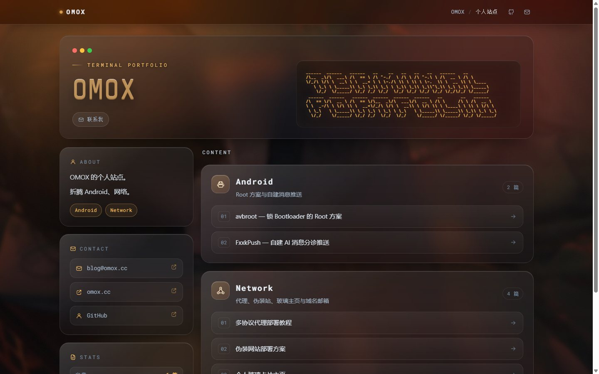
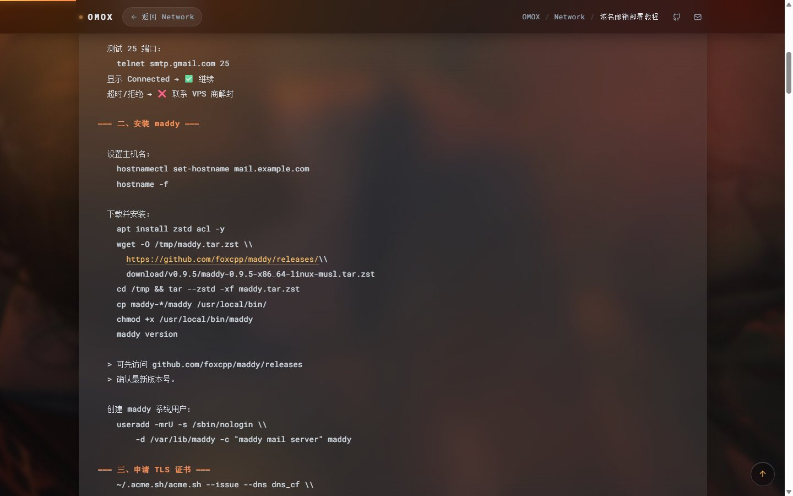
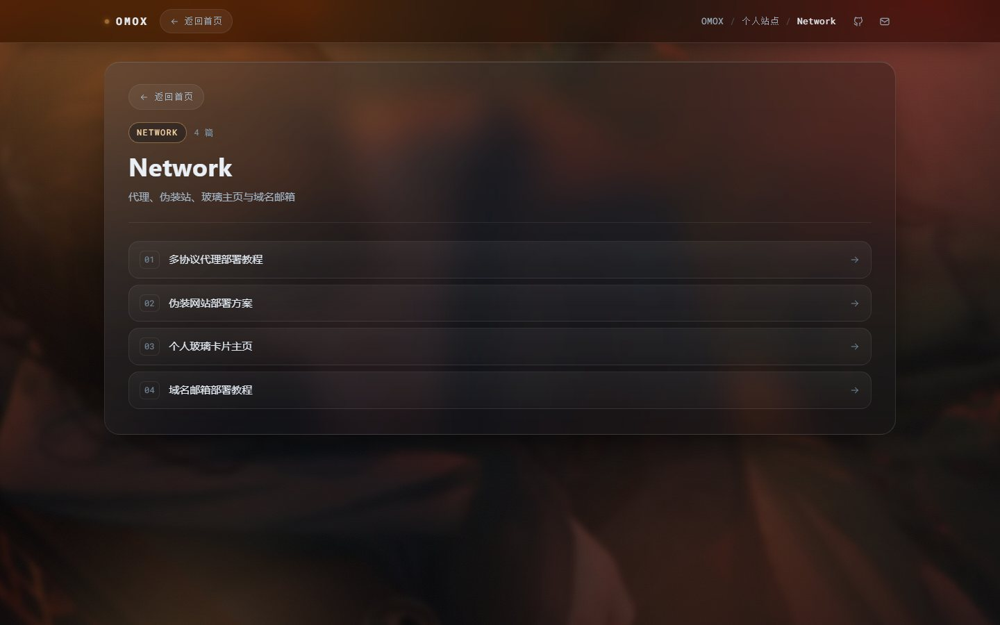

# omox.cc

个人站点的 **毛玻璃 / 液态玻璃** 版本 —— 纯静态、零第三方请求、严格 CSP。
衍生自终端风格主页，内容为 Android Root、网络部署两类共 6 篇教程，点开即读。

| 首页 | 文章页 |
|---|---|
|  |  |

| 分类页 |
|---|
|  |

## 特性

**视觉与交互**
- 毛玻璃卡片浮在 4px 轻模糊的水彩背景上，移动端 `background-position:42%` 保住画面主体
- 三层 3D：卡片鼠标倾斜（`rotateX/rotateY`）、子元素 `translateZ` 分层、标题 `text-shadow` 挤出
- 鼠标跟随打光、文章行流光、滚动进场级联、背景视差
- 详情页「先玻璃板、后逐段文字」的进场时序；分类页行列表按 `820+n×65ms` 逐行刷出
- 分类页路由 `#/c/<key>`：About 标签与分类玻璃板共用；文章行 `closest('a')` 独立走 `#/p/<key>`
- 顶栏常驻返回、浮动回顶、阅读进度条、ASCII 字符画按容器反算字号
- `prefers-reduced-motion` 完整降级（全部元素立即可见、延迟归零）

**性能**
- 首访 **88 KB**（HTML gzip 33 KB + WebP 30 KB + 字体 26 KB），二访 **32 KB**（静态资源走长缓存）
- 字体自托管并按页面实际字符子集化：46.3 KB → **26.9 KB**（-42%），Roboto Mono 可变轴 `wght 100-700` 完整保留
- 背景独立为 `bg.webp`（WebP q75，比同画质 JPEG 小 63%），`<link rel=preload>` 预热
- 进度条由 CSS `animation-timeline: scroll()` 驱动（合成器线程），长文 `content-visibility` 跳过视口外渲染
- 本地实测：FCP 中位 100 ms、`domInteractive` 23 ms、路由切换 13–16 ms

**安全**
- 严格 CSP：`script-src` 只认唯一内联脚本的 `sha256` hash，`font-src 'self'`、`img-src 'self' data:`、`connect-src 'none'`
- 零第三方请求（无 Google Fonts、无 CDN、无统计），无 cookie / fetch / beacon 外传面
- XSS 六向量（内联 script、外域 script、`img onerror`、`iframe srcdoc`、外域 fetch、注入后 eval）实测全拦

## 仓库结构

```
├── omox_glass.html          # 构建产物（页面本体）
├── bg.webp                  # 背景图（WebP，独立缓存）
├── fonts/                   # 自托管字体
│   ├── *.woff2              # 子集版（页面实际在用，26 KB）
│   └── *.woff2.orig         # Google Fonts 原始完整字体（子集化的源）
├── glass_template.html      # 模板（CSS / 结构 / 内联脚本，ASCII banner 已内嵌）
├── omox_text.json           # 文案数据（About + 6 篇正文）
├── build_glass.py           # 构建脚本（压图 / 注入 / 自检 / 字体子集）
└── docs/                    # README 截图
```

## 构建

依赖：`python3` + `Pillow`、`node`（语法自检）、`uv`（字体子集，离线时自动跳过）

```bash
python build_glass.py
```

脚本内置四道自检，不过不写产物：

1. `node --check` —— 内联脚本语法（单文件站没打包器，括号错到浏览器里才发现是白屏）
2. CSP `script-src` hash —— 改文案会改脚本内容，脚本自动把新 hash 同步进 `<meta>` 并复验
3. CSS 25 项关键选择器清单 —— 防正则替换吃掉规则（花括号配对查不出语义损坏）
4. 字体 `cmap` 覆盖 —— 页面用到的每个可打印字符必须在子集里，缺字直接失败（防豆腐块）

**背景图**查找顺序：`OMOX_BG` 环境变量 → 仓库内 `bg_src.jpg` → 本机原路径；都没有则沿用现有 `bg.webp`（所以别人 clone 后不带原图也能正常构建）。

## 内容维护

- **改正文 / 加文章**：编辑 `omox_text.json`（键 `skills-<分类>-<序号>`），再到 `glass_template.html` 的 `CATS` 里挂上条目，跑构建即可
- **加分类**：`CATS` 加一项（`key/name/icon/desc/items`），About 标签与分类页路由会自动跟着生成
- **换背景**：把新图设为 `OMOX_BG` 或放成 `bg_src.jpg`，重新构建
- ⚠️ **务必用 build 出产物**：文案一改，CSP hash 和字体字符集都要跟着变，直接手改 `omox_glass.html` 会触发自检失败

## 部署

四个文件放同一目录上传（只传 HTML 会白背景 + 回退字体）：

```
omox_glass.html  bg.webp  fonts/*.woff2
```

缓存建议（配好才有「二访 32 KB」）：

```caddy
# Caddy
@static path /bg.webp /fonts/*
header @static { Cache-Control "public, max-age=31536000, immutable" }
header        { Cache-Control "public, max-age=300, must-revalidate" }
```

Cloudflare：Cache Rules 里给 `/bg.webp` 与 `/fonts/*` 设 Browser TTL 1 年，其余（HTML）设 5 分钟。
`fonts/*.woff2.orig` 是子集化的源文件，**不要上传**。

## 致谢 / License

- 布局与交互衍生自 [lynx6six/Single-file-Terminal-Portfolio](https://github.com/lynx6six/Single-file-Terminal-Portfolio)，按其声明采用 **MIT License**（全文见下）。感谢原作者。
- 字体：[Roboto Mono](https://fonts.google.com/specimen/Roboto+Mono)（Apache License 2.0）、[Share Tech Mono](https://fonts.google.com/specimen/Share+Tech+Mono)（SIL Open Font License 1.1），均已按本站字符集子集后自托管。
- 背景插画版权归原作者所有，此处经购买授权用于站点展示，**不随本仓库授予任何再分发权利**；替换请自行准备图片。
- 本仓库其余代码与文案未另行授权，保留所有权利。

```
MIT License

Copyright (c) lynx6six

Permission is hereby granted, free of charge, to any person obtaining a copy
of this software and associated documentation files (the "Software"), to deal
in the Software without restriction, including without limitation the rights
to use, copy, modify, merge, publish, distribute, sublicense, and/or sell
copies of the Software, and to permit persons to whom the Software is
furnished to do so, subject to the following conditions:

The above copyright notice and this permission notice shall be included in all
copies or substantial portions of the Software.

THE SOFTWARE IS PROVIDED "AS IS", WITHOUT WARRANTY OF ANY KIND, EXPRESS OR
IMPLIED, INCLUDING BUT NOT LIMITED TO THE WARRANTIES OF MERCHANTABILITY,
FITNESS FOR A PARTICULAR PURPOSE AND NONINFRINGEMENT. IN NO EVENT SHALL THE
AUTHORS OR COPYRIGHT HOLDERS BE LIABLE FOR ANY CLAIM, DAMAGES OR OTHER
LIABILITY, WHETHER IN AN ACTION OF CONTRACT, TORT OR OTHERWISE, ARISING FROM,
OUT OF OR IN CONNECTION WITH THE SOFTWARE OR THE USE OR OTHER DEALINGS IN THE
SOFTWARE.
```
